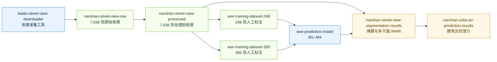

# 高密度城市光伏潜力

本仓库是 CRIBE Lab“高密度城市光伏潜力”研究的数据与模型导航文档，说明 8 个公开仓库之间的关系、各仓库的数据边界，以及从街景采集、窗墙比（Window-to-Wall Ratio, WWR）预测到建筑光伏潜力结果使用的完整路径。

> 本仓库只保存说明文档，不重复存放街景影像、标注、模型权重或预测结果，也不包含任何 API 密钥、访问令牌和云服务凭据。

## 1. 项目总览

研究流程分为四层：

1. **街景获取**：根据 WGS84 坐标、年份和方向获取百度街景。
2. **数据准备**：形成原始街景、处理后街景和人工标注的 WWR 训练集。
3. **WWR 建模**：训练语义分割模型，识别墙体与门窗开口并计算 WWR。
4. **结果应用**：汇总街景分割结果，并结合建筑几何和模拟条件形成屋顶、立面光伏潜力结果。



图中箭头表示研究流程中的上游—下游关系，不代表每个下游仓库都包含从上游重新生成数据的全部程序。详细边界见下表。

## 2. 仓库关系与数据内容

| 仓库 | 类型 | 内容 | 在流程中的作用 |
|---|---|---|---|
| [`baidu-street-view-downloader`](https://github.com/CRIBE-Lab/baidu-street-view-downloader) | 工具 | WGS84 坐标读取、坐标转换、全景 ID 查询、年份选择、多方向下载与断点续传 | 生成自有街景数据的采集入口 |
| [`nanshan-street-view-raw`](https://github.com/CRIBE-Lab/nanshan-street-view-raw) | 数据 | 1,909 个采样点、4 个方向，共 7,636 张 512×512 原始街景 | 南山区研究区的原始影像基线 |
| [`nanshan-street-view-processed`](https://github.com/CRIBE-Lab/nanshan-street-view-processed) | 数据 | 与原始数据逐张对应的 7,636 张 1024×1024 处理后街景 | 标注、分割和 WWR 推理的标准化影像输入 |
| [`wwr-training-dataset-248`](https://github.com/CRIBE-Lab/wwr-training-dataset-248) | 数据 | 248 张图像及同名 X-AnyLabeling JSON；含建筑、窗、门、道路、地面标签 | M1–M4 的训练与模型迭代 |
| [`wwr-training-dataset-300`](https://github.com/CRIBE-Lab/wwr-training-dataset-300) | 数据 | 300 张图像及标注；新增远距离、低建筑占比和大背景样本 | M5 高分辨率对照实验 |
| [`wwr-prediction-model`](https://github.com/CRIBE-Lab/wwr-prediction-model) | 模型 | M1–M5 配置、训练与单图预测程序、模型迭代说明 | 从街景语义分割得到 WWR；论文最终采用 M4 |
| [`nanshan-street-view-segmentation-results`](https://github.com/CRIBE-Lab/nanshan-street-view-segmentation-results) | 结果 | 7,636 张分割掩膜，以及逐图、采样点、80 m 网格和建筑尺度 WWR | 将像素级预测汇总为空间化 WWR 指标 |
| [`nanshan-solar-pv-prediction-results`](https://github.com/CRIBE-Lab/nanshan-solar-pv-prediction-results) | 结果 | 10,068 栋建筑的屋顶、立面和总发电量结果，含 CSV、JSONL、GeoPackage 与图表 | 项目最终光伏潜力成果 |

### 2.1 数据之间如何对应

- 原始与处理后街景均保留采样点 ID、WGS84 经纬度和拍摄方向，可按文件名逐张对应。
- 248 张与 300 张训练集均采用“同名图像 + 同名 JSON”配对。300 张版本包含前 248 张样本，并补充 52 张更复杂的实际街景。
- 分割结果以 `0 = background`、`1 = wall`、`2 = window or door` 编码，WWR 定义为：

```text
WWR = opening_pixels / (wall_pixels + opening_pixels)
```

- 光伏结果将建筑墙体面积与 WWR 结合估算可用立面面积，并与屋顶结果共同形成建筑级光伏潜力。当前正式结果覆盖 10,068 栋建筑：屋顶 659.20 GWh、立面 511.78 GWh、合计 1,170.99 GWh。

## 3. 快速选择

| 目标 | 建议入口 |
|---|---|
| 用自己的坐标采集街景 | `baidu-street-view-downloader` |
| 使用南山区原始或处理后街景 | `nanshan-street-view-raw` / `nanshan-street-view-processed` |
| 训练论文最终采用的 WWR 模型 | `wwr-training-dataset-248` + `wwr-prediction-model` 的 M4 |
| 对比高分辨率预训练模型 | `wwr-training-dataset-300` + M5 |
| 直接分析南山区 WWR | `nanshan-street-view-segmentation-results` |
| 直接分析建筑光伏潜力 | `nanshan-solar-pv-prediction-results` |

## 4. 使用教程

### 4.1 环境准备

建议安装：

- Git；
- Python 3.9 或更高版本；
- [GitHub CLI](https://cli.github.com/)（用于下载 Release 数据，也可以在网页端手动下载）；
- 足够的本地磁盘空间。

以下示例统一使用 HTTPS，不需要在脚本或配置文件中写入 GitHub Token。首次使用 GitHub CLI 时，可按其官方流程在本机完成登录。

### 4.2 用自有坐标采集街景

```bash
git clone https://github.com/CRIBE-Lab/baidu-street-view-downloader.git
cd baidu-street-view-downloader

python -m venv .venv
source .venv/bin/activate
python -m pip install -r requirements.txt

python streetview_download.py \
  --input examples/coordinates.csv \
  --outpath output \
  --year 0 \
  --threads 2
```

输入 CSV 使用 WGS84 坐标，可选第三列自定义 ID：

```csv
POINT_X,POINT_Y,RID
116.397389,39.908722,point_001
```

`--year 0` 表示使用时间线中最新可用年份，也可以传入四位年份。方向、线程数和图像尺寸可通过命令行参数调整：

```bash
python streetview_download.py --help
```

采集前应确认百度地图相关条款、隐私要求、当地法律和合理的访问频率。该工具并非百度官方产品。

### 4.3 下载并校验发布数据

六个数据/结果仓库均通过 GitHub Releases 发布分卷 TAR 文件，并在仓库中提供 `RELEASE_ASSETS.sha256` 和 `MANIFEST.csv`。以原始街景为例：

```bash
git clone https://github.com/CRIBE-Lab/nanshan-street-view-raw.git
cd nanshan-street-view-raw

gh release download v1.0.0 --repo CRIBE-Lab/nanshan-street-view-raw
shasum -a 256 -c RELEASE_ASSETS.sha256

for file in *part-*.tar; do
  tar -xf "$file"
done
```

其他仓库只需替换仓库名：

```text
nanshan-street-view-processed
wwr-training-dataset-248
wwr-training-dataset-300
nanshan-street-view-segmentation-results
nanshan-solar-pv-prediction-results
```

校验分为两层：

1. `RELEASE_ASSETS.sha256` 检查每个下载分卷是否完整；
2. 解压后可根据 `MANIFEST.csv` 检查每个数据文件的相对路径、字节数和 SHA-256。

不要把不同仓库的分卷解压到同一个空目录；建议保留各自的仓库目录，以免同名 `data/` 目录互相覆盖。

### 4.4 复现 M4 WWR 训练

M4 是论文最终采用的两阶段 U-Net：第一阶段提取建筑并抑制道路/地面困难负样本，第二阶段在建筑区域内区分墙体与开口。

先按 4.3 节下载并解压 `wwr-training-dataset-248`，然后准备模型环境：

```bash
git clone https://github.com/CRIBE-Lab/wwr-prediction-model.git
cd wwr-prediction-model

python -m venv .venv
source .venv/bin/activate
pip install -r requirements.txt
```

建议先执行一次单批次检查，确认图像、JSON 标签与运行设备均可用：

```bash
python train.py \
  --config configs/m4.json \
  --data-dir ../wwr-training-dataset-248/data \
  --stage building \
  --check
```

随后分别训练两个阶段：

```bash
python train.py \
  --config configs/m4.json \
  --data-dir ../wwr-training-dataset-248/data \
  --stage building

python train.py \
  --config configs/m4.json \
  --data-dir ../wwr-training-dataset-248/data \
  --stage opening
```

默认输出位置为：

```text
outputs/m4/building/best_model.pth
outputs/m4/opening/best_model.pth
```

配置固定随机种子为 42，训练/验证比例为 80%/20%，并以验证损失保存唯一最佳权重。损失函数为 `0.5 × CrossEntropy + 0.5 × macro Dice`。

### 4.5 用 M4 预测单张街景的 WWR

```bash
python predict.py \
  --image /path/to/street-view.jpg \
  --building-checkpoint outputs/m4/building/best_model.pth \
  --opening-checkpoint outputs/m4/opening/best_model.pth
```

程序在终端输出图像名、墙体像素数、开口像素数和 WWR。仓库不发布论文训练权重，因此该步骤需要使用自行训练得到的两个检查点。

### 4.6 训练 M5 对照模型

M5 使用 300 张训练数据、1024×1024 输入和 ImageNet 预训练的 ResNet18-U-Net。首次运行可能下载 torchvision 预训练权重：

```bash
python train.py \
  --config configs/m5.json \
  --data-dir ../wwr-training-dataset-300/data
```

M5 用于高分辨率和预训练编码器的探索性对照，论文最终模型仍为 M4。

### 4.7 直接使用 WWR 结果

下载并解压 `nanshan-street-view-segmentation-results` 后，主要内容为：

```text
data/
├── masks/<point_id>/*_mask.png
└── tables/
    ├── wwr_predictions.csv
    ├── sample_points_wwr.csv
    ├── grid_80m_wwr.csv
    └── buildings_grid_wwr.csv
```

- `wwr_predictions.csv`：逐图预测；
- `sample_points_wwr.csv`：采样点尺度汇总；
- `grid_80m_wwr.csv`：80 m 网格尺度汇总；
- `buildings_grid_wwr.csv`：建筑尺度的空间关联结果；
- GeoPackage：适合在 QGIS、ArcGIS 或 Python GeoPandas 中进行空间分析。

若只需要论文使用的正式结果，无需重新训练模型，可直接从这些表格开始分析。

### 4.8 直接使用光伏潜力结果

下载并解压 `nanshan-solar-pv-prediction-results`。仓库提供建筑级 CSV、JSONL、GeoPackage、空间分布图和统计图，适用于：

- 比较屋顶与立面光伏潜力；
- 按建筑或空间单元汇总发电量；
- 在 GIS 中制作空间分布图；
- 对接后续规划、能源和碳排放分析。

结果采用 Equivalent One-Diode 光伏模型和逐时动态外部建筑遮挡；屋顶可用比例为 64%，立面面积依据建筑墙体面积与 WWR 计算。该仓库发布的是正式结果，不包含 EnergyPlus 天气文件、失败运行目录、旧版本模型程序或密钥。

## 5. 模型迭代摘要

| 版本 | 核心变化 | 数据量 | 输入尺寸 | 最佳轮次 | 验证损失 |
|---|---|---:|---:|---:|---:|
| M1 | 单阶段三分类 U-Net 基线 | 101 | 512×512 | 54 | 0.4225 |
| M2 | 扩充样本的单阶段三分类 U-Net | 248 | 512×512 | 45 | 0.3095 |
| M3 | 建筑/背景 + 墙体/开口两阶段 U-Net | 248 | 512×512 | 44 / 25 | 0.1270 / 0.2936 |
| **M4** | **加入道路、地面困难负样本的两阶段 U-Net** | **248** | **512×512** | **48 / 28** | **0.2397 / 0.2878** |
| M5 | ImageNet 预训练 ResNet18-U-Net 对照 | 300 | 1024×1024 | 57 | 0.2792 |

M2 证明扩大样本量能改善基线；M3 将建筑定位与开口识别拆分；M4 针对道路和地面误分进行强化，是最终采用版本；M5 检验更大输入尺寸和预训练编码器，但未替代 M4。

## 6. 可复现性与数据边界

| 阶段 | 本项目公开内容 | 使用者需要自行准备的内容 |
|---|---|---|
| 街景采集 | 完整下载脚本与虚构示例坐标 | 合法的研究坐标、网络环境和数据使用依据 |
| 街景处理 | 处理后数据成果 | 历史云模型调用环境和处理凭据未公开 |
| WWR 训练 | 训练数据、M1–M5 代码与配置 | 计算设备；训练产生的权重保存在本地 |
| WWR 结果 | 掩膜与多尺度汇总表 | 若需重新预测，需自行训练权重 |
| 光伏结果 | 正式建筑级结果与图表 | 完整 EnergyPlus 重跑所需的模型程序和天气文件未随结果发布 |

复现研究时请记录仓库提交、Release 标签、Python 版本、依赖版本、运行设备和本地参数。数据仓库当前正式版本均为 `v1.0.0`。

## 7. 安全、授权与引用

- 不要将 `.env`、API Key、Token、Cookie、云服务凭据、请求日志或模型权重提交到公开仓库。
- 街景影像及其处理结果的权利状态不会因本项目发布而改变。使用、展示或再分发前，应确认数据来源条款、隐私要求和适用法律。
- 大文件通过 Releases 获取；不要把解压后的数据目录再次提交到代码仓库。
- 使用具体数据或模型时，请同时引用对应仓库、Release 标签和研究论文；仓库 License 不替代第三方影像授权。

## 8. 参考文档

- [【数据汇总】高密度城市光伏潜力](https://rcnl11j1y8od.feishu.cn/wiki/XPDwwAGupip4HGkGfzecRJDNnrh?from=from_copylink)
- [【模型】WWR预测模型](https://rcnl11j1y8od.feishu.cn/wiki/IjL5wBhjMi8yV5kCHFdcUFwMnPd?from=from_copylink)

如仓库内容与本文档存在差异，以各仓库最新 README、Release 说明和版本记录为准。
